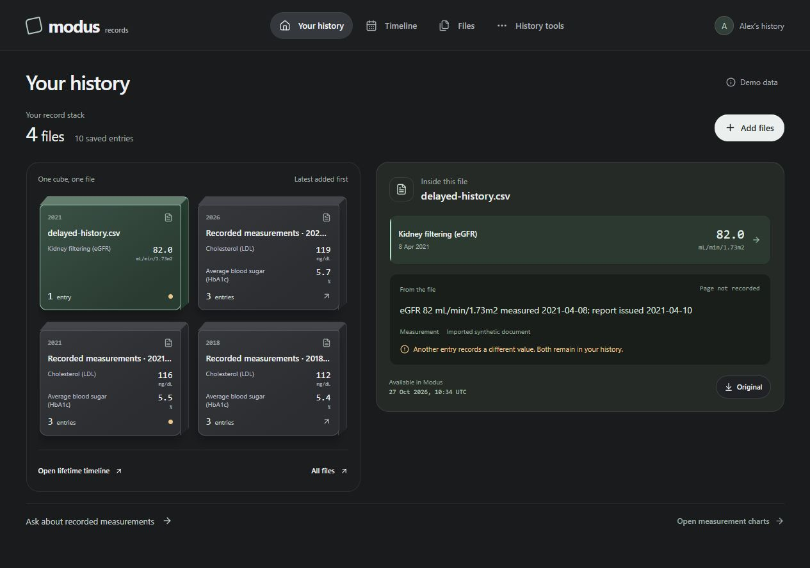

# Modus Records

**Your history, with the evidence beside it.** Upload supported medical records, review the extracted entries, and build a history you can inspect and correct. One source file becomes one cube. Select it to see recorded values, original wording, review edits and the original file.



This repository contains the bounded record-reconciliation application prepared for the Meta Global AI Developer Hackathon. It preserves recorded information and disagreements; it does not generate diagnosis, treatment or medical advice. Organizer eligibility of this concrete health-record workflow remains unconfirmed.

## Run locally

Requires Python 3.11+ and Node.js 20.19+ or 22.12+. From the repository root:

```sh
python scripts/setup_entry.py
python scripts/check_entry.py
python scripts/serve_entry.py --port 8011
```

Open **http://127.0.0.1:8011/**. Setup creates an isolated Python environment and installs locked dependencies. The default mode is deterministic and needs no API key. For optional Meta execution, copy `.env.example` to `.env` and configure the server locally; never put credentials in browser code or Git. Restart the service after configuration changes.

## What works

- Upload up to ten supported files, then review and save each separately. CSV, explicit text and text PDFs have local routes. PNG/JPEG/PDF extraction can use Muse Spark; optional local TeleOCR needs a separately installed environment and checkpoint.
- Timeline and Files retain eight record kinds: measurements, visits, provider-recorded diagnoses, procedures, prescriptions, vaccinations, imaging report text and other recorded text. Original dates, units, partial dates and unknowns remain explicit.
- Models produce proposals; the owner reviews the selection before a transactional save. Original wording, proposed values and review edits remain distinct. Exact retries do not create duplicate records.
- One file produces one cube with real saved-value previews. Selecting it opens source evidence and the permitted original download. Keyboard and phone layouts are supported.
- Historical views filter both when an event happened and when its reviewed record entered Modus. A late upload cannot appear in an earlier availability view. This is availability in Modus, not proof of when the person or clinician first knew something.
- Conflicting values remain visible. Neither source is automatically declared correct.
- The bounded question agent selects read-only tools and supported claims. Its current question tools cover HbA1c, eGFR and LDL; generic questions over all eight record kinds are still pending.

Try **Add files → review → save → select a cube → open evidence**, then use **History tools** to compare an earlier availability cutoff with today's records. Supplied examples are authored synthetic records. No personal medical records are distributed.

## Verification and Meta evidence

The 28 October source-cube workspace passed **920 backend tests, 804 entry tests and 25 frontend tests**, both builds and the offline evaluations. Its clean bounded extract passed **802 tests with two expected compatibility skips**, 25 frontend tests, temporal checks 6/6 and routing 5/5. The skipped compatibility tests require the broader research application, which is intentionally absent here.

An authored image completed real **muse-spark-1.3** extraction, a separate source check and a bounded record-tool loop: **four successful requests**, 17.25 seconds, with no automatic commit. [The retained trace](eval/source-cubes-live-image-20261028.json) includes model/request metadata, usage and stage outcomes. Its estimated uncached usage was $0.02921125; actual billing is unknown. This is one synthetic smoke case, not broad extraction accuracy or a best-workflow result.

The [development comparison](entry/docs/BENCHMARK.md) retains its frozen baseline and distinguishes development tuning from held-out performance. Private held-out inputs and labels are excluded and remain untouched. Software test counts do not establish clinical validation or SOTA superiority.

GitHub Actions is configured to run the entry checks on Windows and Ubuntu with provider access disabled. A configuration file alone does not establish that remote CI has passed; inspect the actual run.

## Current limits

This is a synthetic research prototype. Storage is not encrypted and authenticated owner sessions, cloud-disclosure controls, complete deletion, durable amendments and general undo are unfinished. Do not treat it as a production service for personal medical records. Broad file-layout accuracy, folder/ZIP intake, generic-fact questions and native desktop delivery remain unqualified or incomplete.

Models cannot execute shell commands, SQL, arbitrary URLs, record writes or permission changes. Imported text and model tool arguments are untrusted. Numerical and temporal boundaries are enforced by typed code; a citation ID alone does not prove that a sentence is supported.

## Contributions, rules and licensing

The owner attests that all first-party implementation was created after kickoff. The first Git commit is an honest import of that work on its actual commit date; it does not reconstruct earlier history. AI assistance was used for implementation, design, research and testing. [Contribution record](entry/docs/CONTRIBUTIONS.md).

The supplied participant instructions require public event-built source, a three-minute video with opening contribution disclosure, approved human contributors and no AI medical/health advice. Public source publication does not itself submit the entry or confirm eligibility. The official judging weights and the supplied FAQ conflict; organizer clarification remains pending.

The first-party project license is **undecided**. No open-source license is granted by this README. Third-party libraries, standards and models retain their own terms; see [notices](THIRD_PARTY_NOTICES.md) and [dependency inventory](entry/docs/DEPENDENCIES.json). Model weights, private reference documents, runtime databases, credentials and held-out suites are excluded.

## Further reading

- [Product, architecture, privacy and novelty decisions](docs/PRODUCT_SYSTEM_DECISIONS.md)
- [API contract](entry/docs/API_CONTRACT.md)
- [Agent workflow and evaluation limits](entry/docs/AGENT_WORKFLOW.md)
- [All original product goals and prompt roles](entry/docs/GOALS_AND_PROMPTS.md)
- [Data provenance](entry/docs/DATA.md)
