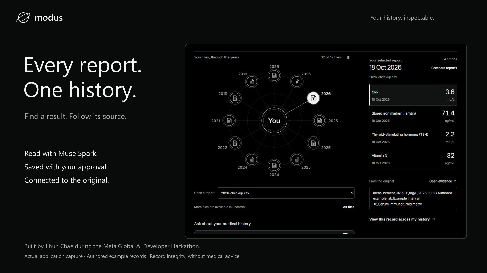
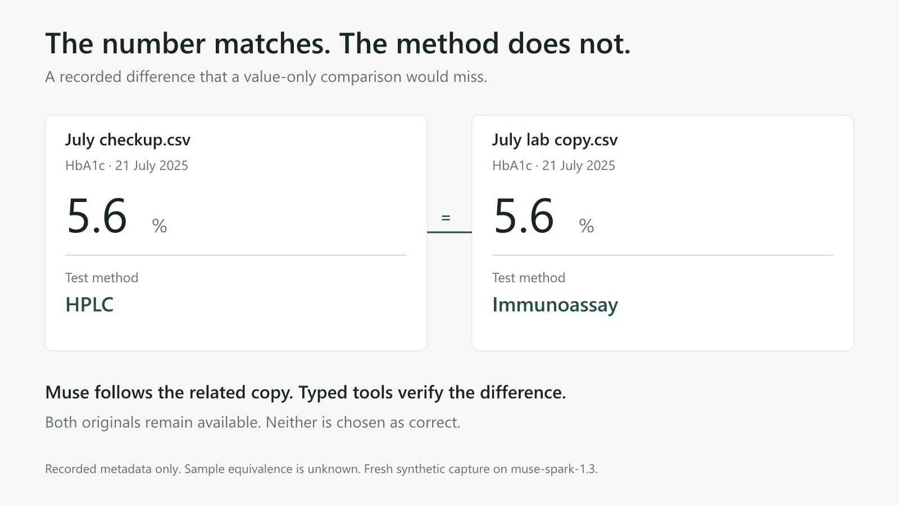
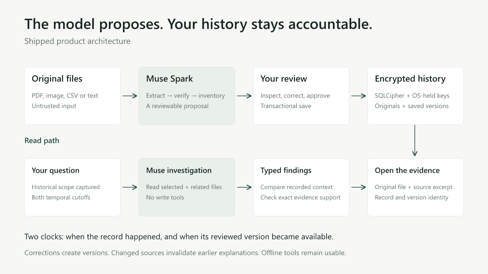

# Modus

Personal medical records, connected across time and traceable to the original.

[Watch the demo · 2:46](https://ji-hun-git.github.io/Modus/) · [Run locally](#run-locally) · [Architecture](#architecture) · [Documentation](#documentation)

[](https://github.com/ji-hun-git/Modus/actions/workflows/verify.yml)

[](https://ji-hun-git.github.io/Modus/)

Medical records arrive in separate files, from different institutions, over many
years. Modus brings them into one history. Find a past result, compare reports,
and inspect the source behind an answer. Corrections preserve the original file
and every earlier saved version.

Built by **Jihun Chae**, solo entrant in the **Meta Global AI Developer Hackathon
2026** — **Indie Developer / Build for Your World**. The application uses Meta
Muse Spark for document reading and factual investigation. All distributed
records are synthetic. Modus does not provide diagnoses or health advice.

## What you can do

1. **Add and review a report.** Import CSV, text, PDF or images. Check proposed
   fields beside the source, correct or exclude entries, then save the reviewed rows.
2. **Find a recorded fact.** Ask “When did I last have blood pressure of 100?”
   Clarify the intended number, then open the dated result and its original.
3. **Compare reports.** Inspect changes and discrepancies across selected reports
   and related files. Conflicting values and missing context remain visible.
4. **Correct without erasing.** Save a reviewed amendment with a reason. Earlier
   versions stay available; explanations using the changed record need refreshing.
5. **Revisit or share a history.** Reconstruct what was available at an earlier
   date, or review a source-linked summary before downloading HTML or JSON.

The [demo](https://ji-hun-git.github.io/Modus/) shows this workflow in the actual
application: history lookup at **0:00**, Muse document reading at **0:32**,
cross-report investigation at **0:50**, and correction and replay at **1:25**.
It includes six real Muse requests; the edit does not represent response latency.
Narration is AI-generated for the video. [Transcript](entry/demo/video-transcript.txt)
· [Recording inputs and receipts](entry/demo/showcase/)

## Why preserving context matters

Two reports can contain the same value and still disagree. In this example,
both report HbA1c as 5.6%, but list different test methods: HPLC and Immunoassay.
Modus surfaces the difference and opens both sources without choosing a winner.



Numerical comparisons use typed tools that check dates, units, reference ranges,
specimen and method. Incompatible or uncertain context can prevent a calculation.
A missing record does not establish that care never happened.

## Architecture



| Layer | Responsibility |
| --- | --- |
| React / TypeScript | File navigation, source inspection, review, questions and summaries. |
| FastAPI / Python | Validate proposals, enforce review, capture history scope and check evidence. |
| Meta Muse Spark | Extract and check document fields; request bounded reads and select supported findings. |
| Typed record tools | Retrieve facts, calculate compatible changes and identify recorded discrepancies. |
| SQLCipher / OS credential store | Store encrypted records and originals; keep the database key in the native credential store. |

Models cannot run shell commands or SQL, open arbitrary URLs, or write records.
Saving requires explicit human review. Offline parsers and record tools work
without model credentials and identify their execution mode.

Every fact has two dates: **when it was recorded** and **when its reviewed
version became available in Modus**. A 2019 result uploaded in 2026 can appear
in today's history without appearing in a view of files available in 2025.

[Agent workflow](entry/docs/AGENT_WORKFLOW.md) · [API contract](entry/docs/API_CONTRACT.md)
· [Two-clock diagram](entry/demo/figures/two-clocks.svg)

## Verification

The current offline suite covers **1,603 backend tests and 240 frontend tests**,
with two backend skips. The production frontend builds, and CI runs on Windows
and Ubuntu. These are software checks, separate from model-quality measurements.

A live development comparison used the same 14 authored three-report cases:

| Version | Expected discrepancies found | False flags | Cases completed |
| --- | ---: | ---: | ---: |
| Baseline `6b2f625` | 4/9 | 5 | 14/14 |
| Revised typed rules `9c6dc2c` | 9/9 | 0 | 14/14 |

Each version made 42 real Muse requests. The comparison rules changed; model
weights and reasoning settings did not. These cases were AI-authored and used
for tuning, with no independent human label review. The result does not measure
general accuracy, scanned-document extraction or clinical performance.
[Method, failures and receipts](entry/docs/VERIFICATION.md#live-cross-report-development-check--4-november-2026)

## Run locally

Requires **Python 3.11+**, **Node.js 20.19+ or 22.12+**, and an unlocked native
credential store: Windows Credential Manager, macOS Keychain or Linux Secret Service.

```sh
git clone https://github.com/ji-hun-git/Modus.git
cd Modus
python scripts/setup_entry.py
python scripts/check_service.py
python scripts/serve_service.py --port 8011
```

Open **http://127.0.0.1:8011/**, choose **Open access file**, and select
`Modus-8011.modus-access` from the location printed by the launcher. Keep that
file private. The checked preview runs offline and verifies source/build identity.

Follow the [sample-record walkthrough](entry/demo/longitudinal/README.md) to try
imports, conflicting results, corrections and replay in a separate workspace.
For frontend development, see the [development guide](entry/frontend/README.md).

## Scope and privacy

Modus is a local, single-owner synthetic prototype. Stored records, originals
and journals are encrypted; local APIs and downloads require a session. Optional
Meta reading sends the selected document or permitted record context to Meta.
Provider credentials remain on the server.

Real-history production qualification, multi-user accounts, portable key
recovery, verified masking/deletion and persistent conversation memory remain
unfinished. Exports are not encrypted by Modus. Moving the database alone is
insufficient for recovery; its original OS-held key is also required.
[Data handling](entry/docs/DATA.md) · [Storage and recovery](entry/docs/API_CONTRACT.md#encrypted-local-storage--4-november-2026)

## Documentation

| Read | Purpose |
| --- | --- |
| [Product guide](entry/docs/PRODUCT.md) | Navigation, review, corrections and historical views. |
| [History questions](entry/docs/WHOLE_HISTORY_AGENT.md) | Supported questions, follow-ups and evidence limits. |
| [Reviewed summaries](entry/docs/RECORD_BRIEF.md) | Select, verify and export a factual record summary. |
| [Agent workflow](entry/docs/AGENT_WORKFLOW.md) | Model roles, tool permissions and evidence checks. |
| [API contract](entry/docs/API_CONTRACT.md) | Routes, schemas, access and storage behavior. |
| [Verification](entry/docs/VERIFICATION.md) | Dated software and live-model evidence. |
| [Contributions](entry/docs/CONTRIBUTIONS.md) | Event-built work, dependencies and AI assistance. |

First-party source is [MIT licensed](LICENSE). Dependencies and other materials
retain their terms in [Third-party notices](THIRD_PARTY_NOTICES.md).
