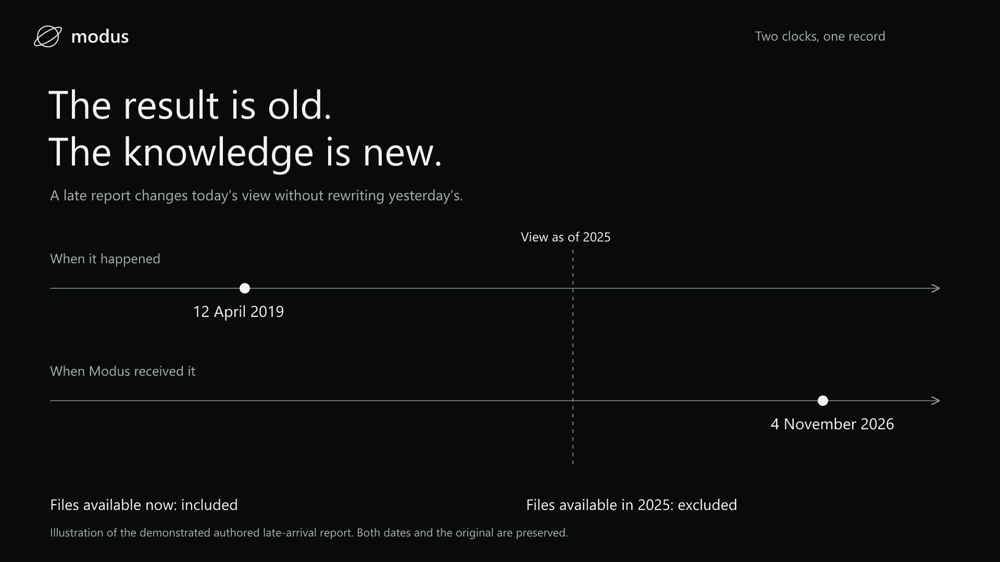

# Modus Records

[](https://ji-hun-git.github.io/Modus/)

**Meta Global AI Developer Hackathon 2026** · **Indie Developer** · **Build for Your World**

Built by **Jihun Chae** (solo). Event contributions: **26 October–4 November 2026**.

Muse Spark reads reports and checks possible omitted rows. You review what enters
your history; original evidence, conflicts and earlier versions stay inspectable.
This entry provides record integrity and source retrieval, without medical advice.
See the [event contribution map](entry/docs/CONTRIBUTIONS.md) and
[reproducible demo walkthrough](entry/demo/longitudinal/README.md).

**[Watch the 1:49 demonstration](https://ji-hun-git.github.io/Modus/).**
The edited recording shows the actual app, authored examples and an existing
genuine Muse draft reopened offline. CSV reading and Ask in this recording are
deterministic; no new model request is presented as live. See the
[recording provenance and limitations](entry/demo/longitudinal/README.md#recorded-demonstration).

[](https://github.com/ji-hun-git/Modus/actions/workflows/verify.yml)

**Ask your history. See the original. Keep every correction.**

Modus brings medical records from different years and files into an inspectable
personal history. Upload a supported report, review the proposed fields, and
follow each saved result back to its source.

## What it does

- Imports CSV, text, PDF and images through supported local or explicitly selected Meta reading paths.
- Requires review before saving. Original files, printed units, dates, lab ranges, specimen and method stay attached to reviewed records.
- Reopens a previously read scan for review while offline, without another model call.
- Lets you review and correct rows flagged by Muse, including additions to an already saved report. Earlier views and original evidence remain intact.
- Finds recorded facts across measurements, visits, prescriptions, vaccinations, procedures, diagnoses as recorded, imaging text and other source text.
- Keeps corrections as new versions. Original excerpts and earlier availability views remain preserved.
- Displays conflicting values without choosing a winner.
- Compares checkups and exports a human-reviewed summary with source evidence.
- Investigates two chosen reports: explains compatible recorded changes, flags context mismatches, and follows same-day discrepancies into related files. Every finding opens its source evidence; no value is chosen as the winner.
- Shows dated measurements alongside clickable original evidence in the file-orbit workspace.

Ask supports exact numeric conditions, earliest/latest matching results, counts,
source-backed histories and recorded differences. Follow-up questions retain
the original condition, units and temporal view.

In **Compare reports**, choose two files and select **Explain changes and
discrepancies**. Ask also accepts two exact filenames in double quotes, such as
`What changed between "2026-checkup.csv" and "2025-checkup.csv"?`.
The offline path is explicitly labelled. The Muse path uses the same bounded
comparison and discrepancy tools. A live development check on 14 authored
three-report cases improved from 4/9 discrepancies caught with 5 false flags to
9/9 with zero false flags after fixing the tools' rules. This is a small,
development-tuned result on reviewed records, not extraction or clinical
accuracy. [Cases, limits and live run receipts](entry/docs/VERIFICATION.md#live-cross-report-development-check--4-november-2026).

## How it works

Modus owns the record lifecycle around the model:

- **Two clocks:** a report from 2019 received in 2026 can update today's history
  while staying outside a view of what was available in 2025.
- **Corrections with memory:** an edited result gets a new saved version. The
  earlier value, correction reason and original excerpt remain inspectable.
- **A controlled save:** extraction proposes; explicit review commits. An
  uncertain save retries the same transaction instead of silently duplicating it.
- **Checkable answers:** typed tools filter, count and compare captured records.
  Values remain linked to their source and version; a citation alone cannot
  justify an unsupported sentence.

These capabilities keep working without a model request. Muse supplies document
reading and bounded investigation; Modus supplies the history, authority checks
and evidence workflow. This is an architectural distinction from a simple
document-chat interface, not a claim of unique invention or superior model accuracy.


Muse proposes fields and possible omissions. Explicit review controls record
writes. Questions use a captured historical scope, bounded read-only tools and
checked source support. The shipped document guard is deterministic; SAM and
hosted Guard are not included. [Workflow contract](entry/docs/AGENT_WORKFLOW.md)
· [Full-size editable diagram](entry/demo/figures/architecture.svg).



A report's recorded date and the date it became available are separate. Late
files can change today's reconstruction while an earlier knowledge view stays
intact. The figure uses the authored example shown in the video.

## Run locally

Requires Python 3.11+ and Node.js 20.19+ or 22.12+, with an unlocked native OS
credential store (Windows Credential Manager, macOS Keychain, or Linux Secret Service).

```sh
python scripts/setup_entry.py
python scripts/check_service.py
python scripts/serve_service.py --port 8011
```

Open **http://127.0.0.1:8011/**. This checked development preview verifies the
source and frontend build, strips model credentials and runs offline. Saved data
stays in the ignored SQLCipher-encrypted local database across restarts. Its
random 256-bit key stays in the OS credential store, separate from the browser's
access file. Tests use isolated disposable keys and real encrypted databases.

For an existing plaintext database, stop its service first, then run:

```sh
python scripts/encrypt_records.py release/offline-service/records.db --execute
```

The explicit migration verifies every stored value and original file before
replacing the database, and leaves an independently verified encrypted recovery
copy. It refuses active locks or outstanding journals. The app will not silently
open plaintext storage, replace missing history, or generate a replacement for
a missing key. Keep the database's `.modus-vault.json` metadata with the database;
recovery also requires the original OS credential entry. Copying files alone to
another computer is insufficient. See [storage and recovery](entry/docs/API_CONTRACT.md#encrypted-local-storage--4-november-2026).

Choose **Open access file** and select the `Modus-8011.modus-access` file at
the location printed by the launcher. Keep it private. Restarting replaces it;
reloading the browser requires opening it again. **More → Lock records** locks
every session. Sessions expire after 30 minutes without activity or 8 hours total.

The checked launcher restricts its data directory and access file to the OS
owner. Record APIs, originals and exports require a short-lived local session.
Session credentials stay in memory, outside browser storage, cookies and URLs.
The API also blocks cross-origin browser requests, requires an explicit header for
writes, bounds uploads before parsing and prevents browser caching of responses.
Errors omit raw validation input, and request URLs are not written to access
logs. These [local protections](entry/docs/API_CONTRACT.md#local-privacy-boundary--3-november-2026)
preserve original evidence and complement encrypted storage. They are not
multi-user authentication.

For Vite development, start the checked backend with `--port 8011 --ui-port 5174`,
then run `npm run dev` in `entry/frontend` and open `http://127.0.0.1:5174`.
Use the generated `Modus-5174.modus-access` file. Access is bound to that proxy
origin; the backend's direct browser origin cannot unlock the same session.

The starter records and supplied examples are authored synthetic data. They are
not a real person's history or evidence of clinical validation.

For a separate recording rehearsal, choose a free port and a take name:

```sh
python scripts/serve_service.py --rehearsal take-01 --port 8035
```

This uses `release/rehearsal-take-01`, with its own encrypted records, OS-stored
key and access file. Restarting the same name resumes that take. A new name
starts from the authored starter records; it never resets the normal workspace
or an earlier take. Only one checked launcher may own a workspace at a time.
All takes remain offline. The [recording walkthrough](entry/demo/longitudinal/README.md)
uses reviewed imports, original evidence, corrections, conflicts and late arrivals.

## Models and evidence

Meta Muse Spark is the only hosted model in the product path. Explicit model
reading proposes structured fields for review; permitted agent reads operate on
captured history. Deterministic tools compute authoritative numbers. A model
cannot execute SQL or shell commands, fetch arbitrary URLs, write records or
change permissions.

Model execution and offline computation are labelled separately. Credentials
belong only in server environment variables, never browser code, Git or CI.
Test transports are not live-model evidence. [Workflow](entry/docs/AGENT_WORKFLOW.md)
and [verification boundaries](entry/docs/VERIFICATION.md) describe the contracts.

A small live development probe exercised report extraction, explicit review and
bounded Ask, exposing and fixing boilerplate extraction and fixed-filter tool-call
failures. Its [results and limitations](entry/docs/VERIFICATION.md#live-report-reading-and-bounded-ask--3-november-2026)
are separate from protected evaluations and do not establish general accuracy.
A [harder six-report follow-up](entry/docs/VERIFICATION.md#harder-live-report-probes--3-november-2026)
reports exact row errors, false omission flags and unresolved date-label ambiguity.
A [dense-report follow-up](entry/docs/VERIFICATION.md#dense-reports-and-multiline-evidence--3-november-2026)
fixes truncated drafts and multiline source evidence, with all 66 authored entries
returned in the final live pass. These remain development results, not general accuracy.
A [scanned-report probe](entry/docs/VERIFICATION.md#scanned-reports-and-offline-review-recovery--3-november-2026)
returned 84/84 authored results in both live passes with no false omission flags.
Controlled deletion checks detected 84/84 removed rows in each pass; natural
omission recall remains unmeasured. The probe also fixed scan consistency checks
and exposed an offline draft-recovery issue, now covered by browser verification.

## Limits

This is a local, single-owner record-integrity prototype. It does not generate
diagnoses, clinical interpretation, risk scores or treatment advice. Recorded
dates and missing data do not establish whether care occurred. Unknown units,
incomplete dates and incompatible lab context can prevent a numerical comparison.

Production accounts, portable key recovery, verified masking/deletion and
durable personal conversational memory are unfinished. Encryption covers the
record database, its saved originals and database journals; it does not encrypt
files you upload from elsewhere or exports you download. Migration does not
securely erase old disk blocks, snapshots or earlier copies. The service has
not been qualified for real-history production use.

The offline service check is a software regression gate, not a model-quality
evaluation or final release qualification. Historical measured results remain
version-specific in [SCOREBOARD.md](SCOREBOARD.md); they must not be generalized
to later code or broader medical tasks.

## Documentation

- [Product flow](entry/docs/PRODUCT.md)
- [API contract](entry/docs/API_CONTRACT.md)
- [Data provenance](entry/docs/DATA.md)
- [Record terminology](entry/docs/TERMINOLOGY_RETRIEVAL.md)
- [Reviewed summaries](entry/docs/RECORD_BRIEF.md)
- [Contributions](entry/docs/CONTRIBUTIONS.md)

First-party Modus source is available under the [MIT License](LICENSE).
Third-party materials retain their own terms, documented in
[THIRD_PARTY_NOTICES.md](THIRD_PARTY_NOTICES.md).
