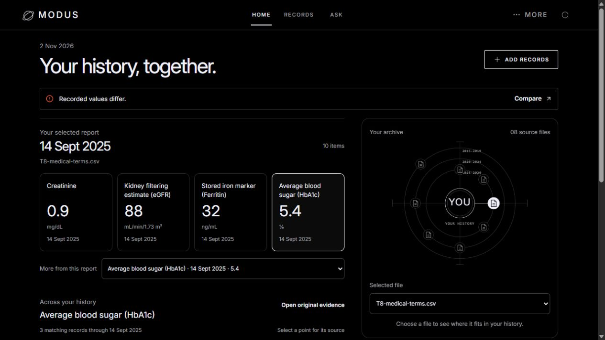

# Modus Records

[](https://github.com/ji-hun-git/Modus/actions/workflows/verify.yml)

**Ask your history. See the original. Keep every correction.**

Medical records arrive across years, files and institutions. Modus brings their recorded facts into one inspectable timeline. Ask for a past result, follow it to its source, and correct a transcription without erasing what the original said.

This is the bounded **record-integrity** entry for the Meta Global AI Developer Hackathon. It does not generate diagnoses, clinical interpretations, risk scores or treatment advice. The distributed examples are synthetic.

## The working flow

1. **Add a report.** Choose supported CSV, text, PDF or image files. Local text parsing works offline; explicitly selected model reading uses Meta Muse Spark.
2. **Review before saving.** Compare proposed fields with the original excerpt, edit or exclude them, and approve the transaction.
3. **Ask your history.** For example: “What is my latest heart rate record?” Medical-name mappings can find Pulse while preserving its original label and units.
4. **Continue the question.** “What about the one before that?” returns the previous dated group for the same subject and captured history, including ties and date limitations.
5. **Open the evidence.** Each finding opens its supporting saved record and original excerpt/file.
6. **Correct and revisit.** Review an append-only correction, then ask the original question with updated records. Earlier availability views still show the earlier saved version.



Home keeps the owner at the center of a source-file orbit. Each satellite opens a real file; the timeline and source inspector use recorded dates. Records, Ask, generic Trends, historical Replay and a reviewed exportable Brief share the same evidence boundaries.

Home now exposes up to four readings, familiar medical names, the selected reading's history and a direct Ask bar. Additional fields remain available in the report selector. Every chart point opens evidence. [Visible changes and browser verification](docs/T11_REPORT_FIRST_HOME_2026-11-02.md).

## What is technically different

| Capability | Concrete behavior |
| --- | --- |
| Two-clock history | Occurrence date and server-owned availability are separate. A late upload or correction cannot appear in an earlier availability view. |
| Preserved evidence | Original bytes, excerpts, units, unknowns and conflicting values survive review and later amendments. Conflicts have no automatic winner. |
| Human-reviewed writes | Extraction proposes; only explicit reviewed rows commit. Transactions are idempotent and uncertain saves can recover their receipts. |
| Bounded agent | Meta can request allowlisted reads and select exact tool-produced claims. It cannot write records, execute SQL/shell or browse arbitrary URLs. |
| Safe follow-ups | Short-lived opaque context binds the original query, date boundary and availability. Expired or changed context asks for a full question instead of guessing. |
| Bounded browsing | Pages and source selectors render a limited window; retrieval still searches the captured history. |

Eight kinds are supported: measurements, visits, recorded diagnoses, procedures, prescriptions, vaccinations, imaging report text and other recorded text. Measurement names are not restricted to three metrics. Naming retrieval includes 24 measurement concepts and five additional record topics; it is controlled terminology matching, not a neural semantic model or a comprehensive medical ontology.

## Meta's role and proof boundaries

Muse Spark (`muse-spark-1.3`) is the only model family in the product path: document extraction/checking and bounded factual investigation. Whole-report reading groups up to 12 pages into extract/check passes and exposes incomplete processing. Deterministic parsing, calculations, follow-up navigation and the current instruction guard are ordinary software, explicitly labelled when no model is called.

Earlier live image/PDF extraction and agent calls are documented in the repository. **The latest whole-history and conversation changes are verified offline, not newly qualified against live Muse.** SAM source-region highlights and hosted Guard are not demonstrated product capabilities. No SOTA or clinical-validation claim is made.

Modus runs entirely on Meta models when model execution is selected. Its isolated evaluation uses a cross-provider judge panel (Meta Muse, Anthropic Claude, OpenAI) to avoid single-model self-preference. Earlier evaluation results remain version-specific; small AI-authored labels and unmeasured human agreement limit their conclusions. [Historical scoreboard](SCOREBOARD.md).

## Run and check

Requires Python 3.11+ and Node.js 20.19+ or 22.12+.

```sh
python scripts/setup_entry.py
python scripts/check_service.py
```

`check_service.py` runs selected service regressions, frontend tests and the build with credentials removed, external networking blocked in backend checks, and evaluation/held-out access forbidden. Logs and source hashes go to ignored `release/service-check/`. CI runs this check on Windows and Ubuntu.

This check **does not mint a final release gate**. For a full local release qualification, the existing commands remain:

```sh
python scripts/check_entry.py
python scripts/serve_entry.py --port 8011
```

The full check includes development evaluations. It was intentionally not rerun for the current offline service iteration; older release stamps are not evidence for changed source. The server refuses a stale release gate. Closed held-outs must not be rerun to qualify newer work.

Default operation is offline. Optional Meta credentials belong only in server environment variables (`MODUS_META_KEY`, with legacy `MODEL_API_KEY` fallback); never in browser code, Git or CI. Restart after runtime/configuration changes.

## Status and limits

[Current service verification and remaining work](docs/T10_SERVICE_COMPLETION_2026-11-02.md) separates software checks, browser evidence and unproven live-model quality. Follow-up memory expires after 30 minutes, capacity eviction or restart; it is not persistent personal memory. Arbitrary conversational references, numerical predicates beyond the dedicated BP lookup, appointments/reminders and clinical interpretation are not supplied by this feature.

This is a local, single-owner synthetic prototype. Account authorization, encryption at rest, measured identifier masking, deletion/recovery and real-history privacy qualification remain unfinished. Original excerpts and images may contain identifiers; do not treat safe tool projections as automatic anonymization.

## Competition delivery

The competition source is selected by `entry/config/source_manifest.json`; broader clinical research, private reference material, databases and credentials are excluded. This update is a source candidate, not the final frozen submission. Organizer eligibility confirmation and the video/submission remain owner-managed.

**LICENSE: undecided.** Jason must select a first-party license before final submission. No open-source license is granted by this README. [Third-party notices](THIRD_PARTY_NOTICES.md) retain their own terms.

- [API contract](entry/docs/API_CONTRACT.md)
- [Competition readiness and remaining blockers](COMPETITION_CHECKLIST.md)
- [Agent workflow](entry/docs/AGENT_WORKFLOW.md)
- [Original goals and prompt continuity](entry/docs/GOALS_AND_PROMPTS.md)
- [Data provenance](entry/docs/DATA.md)
- [Participant rules and conservative operating deadline](research/DISCORD_RULES_2026-10-29.md)
