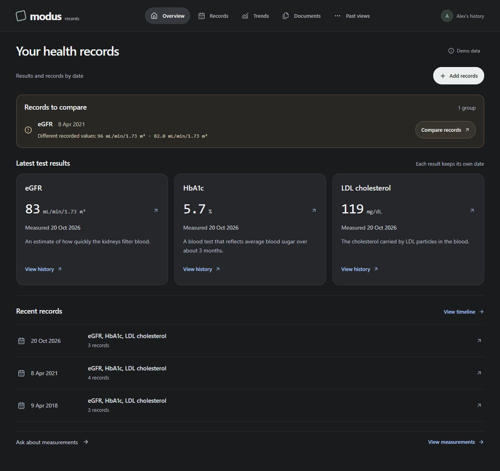

# Modus Records

**Your history, with the evidence beside it.** Upload supported medical records, review the extracted entries, and build a history you can inspect and correct. Home shows up to four latest result groups, a compact Ask bar and one Add records action. Open any result to inspect its original wording and review edits. Documents keeps one source file per cube.



This repository contains the bounded record-reconciliation application prepared for the Meta Global AI Developer Hackathon. It preserves recorded information and disagreements; it does not generate diagnosis, treatment or medical advice. Organizer eligibility of this concrete health-record workflow remains unconfirmed.

## Run locally

Requires Python 3.11+ and Node.js 20.19+ or 22.12+. From the repository root:

```sh
python scripts/setup_entry.py
python scripts/check_entry.py
python scripts/serve_entry.py --port 8011
```

Open **http://127.0.0.1:8011/**. Setup creates an isolated Python environment and installs locked dependencies. The default mode is deterministic and needs no API key. For optional Meta execution, copy `.env.example` to `.env` and configure the server locally; never put credentials in browser code or Git. Restart the service after configuration changes.

## What works

- Upload up to ten supported files, then review and save each separately. CSV, explicit text and text PDFs have local routes. PNG/JPEG/PDF extraction can use Muse Spark; optional local TeleOCR needs a separately installed environment and checkpoint.
- Records and Documents retain eight record kinds: measurements, visits, provider-recorded diagnoses, procedures, prescriptions, vaccinations, imaging report text and other recorded text. Original dates, units, partial dates and unknowns remain explicit.
- Models produce proposals; the owner reviews the selection before a transactional save. Original wording, proposed values and review edits remain distinct. Exact retries do not create duplicate records.
- Home selects up to four latest result groups by occurrence date and retains tied results. A compact conflict notice opens a side-by-side comparison; See all records opens the complete timeline, including partial or missing dates. Documents keeps a cube shelf and list, with filenames and upload timestamps in source details. Keyboard and phone layouts are supported.
- Historical views filter both when an event happened and when its reviewed record entered Modus. A late upload cannot appear in an earlier availability view. This is availability in Modus, not proof of when the person or clinician first knew something.
- Conflicting values remain visible. Neither source is automatically declared correct.
- Prepare a brief from the records you choose. Review the full selection and any added conflicting values before downloading self-contained HTML or JSON, with dates, source excerpts and internal citations. HTML can be opened in a browser and printed; native PDF export is not implemented. [Brief workflow and limits](entry/docs/RECORD_BRIEF.md).
- The bounded question agent selects read-only tools and supported claims. Home, Records and Documents now answer questions across all eight reviewed record kinds, including arbitrary measurement names, with literal source search and fixed date/availability bounds. The legacy Trends/Replay interface remains limited to HbA1c, eGFR and LDL.

Try **Add records → review → save → open a result → inspect evidence**, then use **More → Replay** to compare an earlier availability cutoff with today's records. Supplied examples are authored synthetic records. No personal medical records are distributed.

Home, Records and Ask are the three primary destinations. **More** contains Brief, Trends, Documents, Replay and Changes. Date controls collapse into a single **View as of** chip. [Current review and remaining work](entry/docs/REVIEW_READINESS_2026-10-28.md).

## Verification and Meta evidence

The reviewed-brief milestone passes **1,042 backend / 926 entry / 55 frontend tests**, both builds and offline evaluations. Actual browser checks cover four newly authored uploads, all eight record kinds, selection, source inspection, review, HTML/JSON downloads, and stale-preview rejection. Ten selected records produce eleven exported records because a conflicting laboratory copy is explicitly retained. [Browser evidence](eval/record-brief-browser-20261028.json). These changes made zero provider requests and did not access held-outs or frozen baselines. User-value testing remains proposed, not completed.

The shared interface uses self-hosted Inter, a restrained blue action palette, clearer hierarchy and responsive controls. [Meta design research and font provenance](research/META_DESIGN_APPLICATION_2026-10-28.md) distinguishes the official sources from Modus's own design choices.

The whole-history extension passes **994 backend / 878 entry / 48 frontend tests**, both builds and offline evaluations. On 16 newly authored development cases, the unchanged legacy path passes 4/16 and the new path 16/16; these deliberately measure expanded coverage, not independent superiority. [Agent and limits](entry/docs/WHOLE_HISTORY_AGENT.md) · [Measured development results](eval/history-agent-development.json).

A new whole-history prescription question passed with **two real Muse Spark requests**, exact source-linked findings and an unchanged temporary store. [Live trace](eval/history-agent-live-20261028.json). Two additional synthetic calls occurred when a direct legacy pytest invocation inherited local provider configuration; the incident is retained and ordinary pytest now forces offline credentials. [Incident](eval/history-agent-test-isolation-incident-20261028.json). Cumulative provider evidence is 24 requests, 22 successful responses and two earlier HTTP errors. No broad extraction or model-quality claim follows from these smokes.

The 28 October result-centered UI workspace passed **920 backend tests, 804 entry tests and 42 frontend tests**, both builds and the offline evaluations. The previous public import passed a fresh anonymous clone check (**802 tests + two expected compatibility skips**) and GitHub Actions on Windows and Ubuntu. The two skipped compatibility tests require the broader research application, intentionally absent here. Inspect the current commit's Actions run for its independent result.

An authored image completed real **muse-spark-1.3** extraction, a separate source check and a bounded record-tool loop: **four successful requests**, 17.25 seconds, with no automatic commit. [The retained trace](eval/source-cubes-live-image-20261028.json) includes model/request metadata, usage and stage outcomes. Its estimated uncached usage was $0.02921125; actual billing is unknown. This is one synthetic smoke case, not broad extraction accuracy or a best-workflow result.

The [development comparison](entry/docs/BENCHMARK.md) retains its frozen baseline and distinguishes development tuning from held-out performance. Private held-out inputs and labels are excluded and remain untouched. Software test counts do not establish clinical validation or SOTA superiority.

GitHub Actions is configured to run the entry checks on Windows and Ubuntu with provider access disabled. [Inspect actual CI runs](https://github.com/ji-hun-git/Modus/actions).

## Current limits

This is a synthetic research prototype. Storage is not encrypted and authenticated owner sessions, cloud-disclosure controls, complete deletion, durable amendments and general undo are unfinished. Do not treat it as a production service for personal medical records. Broad file-layout accuracy, folder/ZIP intake and native desktop delivery remain unqualified or incomplete.

Models cannot execute shell commands, SQL, arbitrary URLs, record writes or permission changes. Imported text and model tool arguments are untrusted. Numerical and temporal boundaries are enforced by typed code; a citation ID alone does not prove that a sentence is supported.

## Contributions, rules and licensing

The owner attests that all first-party implementation was created after kickoff. The first Git commit is an honest import of that work on its actual commit date; it does not reconstruct earlier history. AI assistance was used for implementation, design, research and testing. [Contribution record](entry/docs/CONTRIBUTIONS.md).

The supplied participant instructions require public event-built source, a three-minute video with opening contribution disclosure, approved human contributors and no AI medical/health advice. Public source publication does not itself submit the entry or confirm eligibility. The official judging weights and the supplied FAQ conflict; organizer clarification remains pending.

The first-party project license is **undecided**. No open-source license is granted by this README. Third-party libraries, standards and models retain their own terms; see [notices](THIRD_PARTY_NOTICES.md) and [dependency inventory](entry/docs/DEPENDENCIES.json). Model weights, private reference documents, runtime databases, credentials and held-out suites are excluded.

## Further reading

- [Product, architecture, privacy and novelty decisions](docs/PRODUCT_SYSTEM_DECISIONS.md)
- [API contract](entry/docs/API_CONTRACT.md)
- [Agent workflow and evaluation limits](entry/docs/AGENT_WORKFLOW.md)
- [All original product goals and prompt roles](entry/docs/GOALS_AND_PROMPTS.md)
- [Data provenance](entry/docs/DATA.md)
