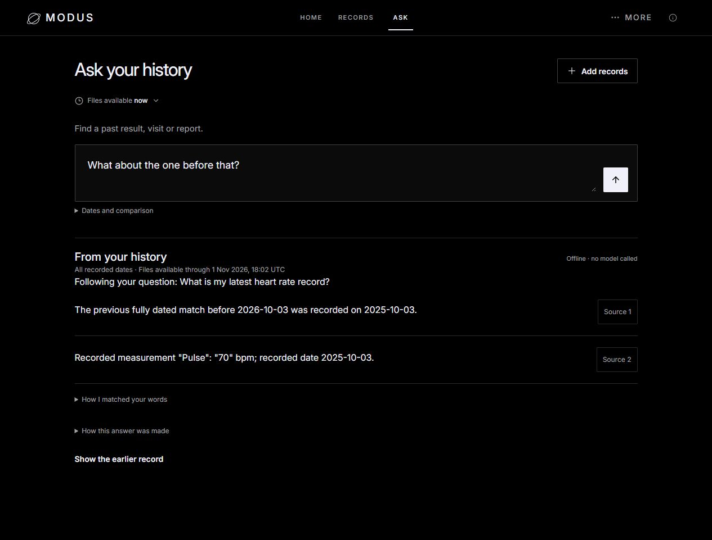
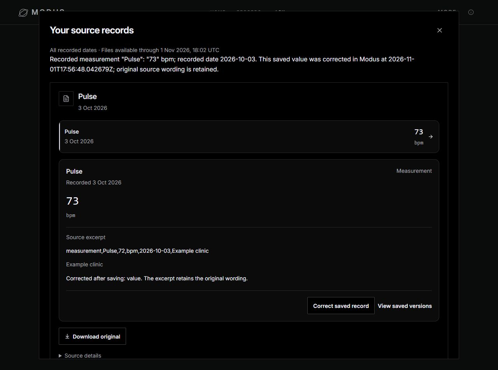

# T10: a complete record conversation

Status: offline service candidate, 2 November 2026 KST. This is software verification, not a model-quality or clinical-validation claim.

## Working owner flow

Import a report, compare extracted rows with the source, approve the rows, ask for the latest result, ask “What about the one before that?”, open its evidence, and correct a saved transcription. After saving, **Ask original question with updated records** returns to the original subject in a newly captured view. It does not silently rewrite an earlier answer.

The browser check imported three authored Pulse readings: 68 (2024), 70 (2025), and 72 (2026). “Latest heart rate” found 72; the follow-up found 70. A reviewed correction changed the saved 72 to 73. Refreshing the original question showed 73, while its original excerpt and downloaded CSV still contained 72. The old availability snapshot still answered 72 and saved versions contained both values.

## Boundaries

- Server-owned, opaque continuation tokens retain the original typed query and date/availability bounds. They expire after 30 minutes, capacity eviction (256 entries), or process restart.
- Follow-ups navigate strictly earlier fully dated groups. Same-day ties remain together; partial/unknown dates retain their caveats. No earlier match does not establish that something never happened.
- Changed scopes, expired tokens, missing context and modified follow-up instructions ask for a complete question. A token cannot supply new tool arguments or authorize writes.
- This is bounded conversational continuity, not permanent personal memory or general pronoun resolution. The local single-owner service does not treat tokens as account authentication.
- Edited questions hide stale answers and cancel pending requests. Scope changes clear the continuation. Correction refresh waits for a newer availability view.
- The current-date chip says “Files available now”; historical availability remains explicit. Local calendar-day rollover is separate from UTC evidence timestamps. The orbit layout is preserved.

## Verification

Command: `python scripts/check_service.py`.

| Check | Result |
| --- | --- |
| Selected backend service tests in the full workspace | 973 passed; one existing Starlette/httpx deprecation warning |
| Same checker in the allowlisted public checkout | 971 passed, 2 expected skips for absent research-only `modus.memory` wrappers |
| Frontend tests | 141 passed |
| TypeScript + Vite production build | Passed |
| Source identity before/after checks | Unchanged |
| Evaluation/secret access guard | No blocked attempts in the successful run |
| Browser import → review → save → Ask → follow-up → source → correction → refreshed Ask | Passed on a disposable synthetic database |
| Original download and saved-version integrity | Exact original CSV bytes; original 72 and corrected 73 retained |
| Concurrent latest/follow-up loopback reads | 64/64 passed, 8 workers, p95 191 ms, max 251 ms; warm local synthetic workload |
| Model requests / spend this iteration | 0 / 0 |

The concurrent diagnostic initially compared the entire response scope object. That incorrectly required identical per-response capture timestamps and identities. The corrected assertion checks the binding event-date and availability boundaries; both remain unchanged. This was a diagnostic correction, not a product relaxation. These figures are not a frozen baseline comparison, held-out score, or production capacity claim.

The wider workspace runner also passed 990 backend tests before the final frontend date-label adjustment. The portable candidate check deliberately selects 973 tests in the competition allowlist. The public checkout also passed all 141 frontend tests and its production build, with unchanged behavior hashes. No evaluation or closed held-out corpus was read, run or modified. No final release-gate stamp was regenerated.

## Competition source update

The public candidate uses the exact source allowlist, excluding protected evaluation artifacts from this synchronization. Historical published evaluation files remain as they were. Current CI runs **offline service regression** on Windows and Ubuntu; it must not be described as the full release gate. The release-check scripts remain available and unchanged in purpose. A full release check has not qualified this source revision.

The README describes the actual owner flow, Meta's role, current evidence, privacy limits and license status. Screenshots show the authored synthetic browser exercise. No credentials, databases, private reference kit or raw user history belong in this source update.

## Still missing

1. Live Muse qualification of the current whole-report, whole-history and follow-up integration; no claim that offline tests measure live model quality.
2. Independently reviewed labels, broader language/document quality evidence and human agreement. Closed held-outs stay closed.
3. Proven SAM region grounding and hosted Guard integration. They are not demonstrated capabilities.
4. Persistent consented personal memory, general conversational references, appointments and reminders. These require explicit product scope and privacy work.
5. Account authorization, encryption at rest, measured identifier masking, deletion/recovery and real-data privacy qualification.
6. Jason's license choice and organizer eligibility confirmation, final source freeze and release qualification, submission and video. No video or organizer contact was performed here.

Record lookup and terminology are not diagnosis, risk scoring, treatment advice or a clinically validated medical model.
