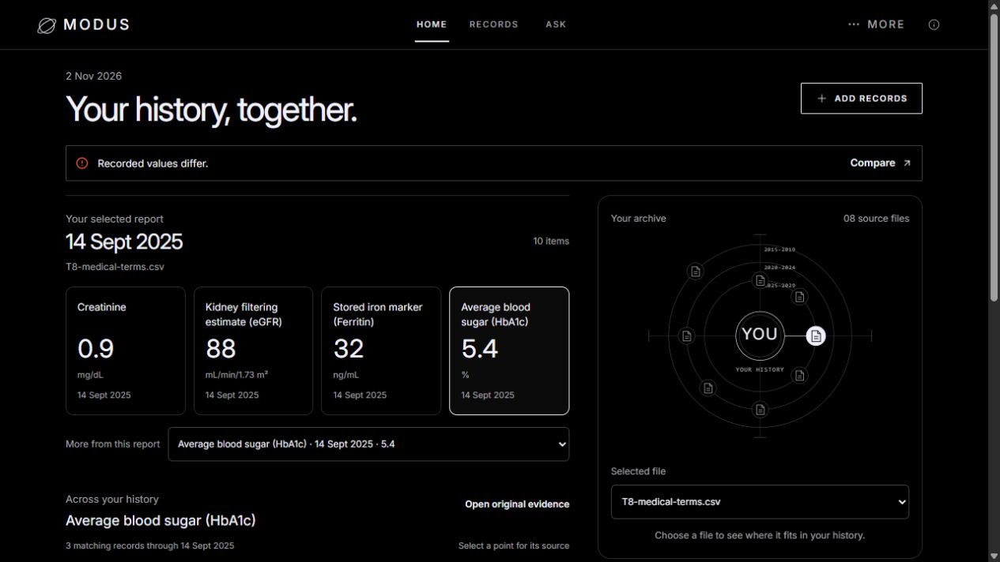

# T11 — visible report-first Home

2 November 2026 KST. Offline service/UI iteration, not a live-model evaluation.

## What an owner can now do

Home opens with the selected report and up to four visible recorded readings. Selecting one opens its dated history immediately, without opening an earlier-results accordion. Click a chart point to inspect the exact source record, excerpt and available original. A ten-field report was verified with Ferritin, HbA1c and the remaining field selector; arbitrary recorded names are preserved.

The orbit remains a file navigator with the owner at its center. Compact nodes no longer carry overlapping tiny labels; native file selection and accessible names retain the complete filenames. A single Home Ask bar opens an answer in the same captured date/availability scope. Earlier-record follow-up, original evidence and saved corrections use the existing bounded service.

## Skills applied

- [Anthropic frontend-design](https://github.com/anthropics/skills/tree/main/skills/frontend-design): plan against the actual brief, make the report the first useful content, preserve the owner's chosen black/white orbit identity, and critique a working screenshot.
- [Vercel web-design-guidelines](https://github.com/vercel-labs/agent-skills/tree/main/skills/web-design-guidelines): labelled controls, keyboard/focus handling, bounded lists, loading states, readable mobile controls and source navigation.

Both were installed in the developer's personal skill directory, outside the application and public source. They add no product dependency, model call or third-party access. No popularity ranking or design-quality score was measured. [Design decisions](design/HOME_REPORT_FIRST.md).

## Findings fixed during the actual browser pass

- `entry/frontend/src/HealthRecordOverview.tsx`: hidden reading dropdown and collapsed history replaced by visible choices and an immediate history view; stale file fields clear during source changes.
- `entry/frontend/src/home-report-focus.css`: chart positioning was previously scoped only to Trends. Home now has its own positioned, keyboard-focusable points. Mobile extra-field controls have a 44px minimum height.
- `entry/frontend/src/OrbitMap.tsx`: compact orbit label overlap removed, with a native file selector as a full-name alternative.
- `entry/frontend/src/ui.tsx`: Escape previously closed both nested source and Ask dialogs. Only the top layer now owns focus and Escape; closing evidence returns focus to its source button and preserves the answer. Background scrolling stays locked until the last dialog closes.
- `entry/frontend/src/HomeRecordSeries.tsx`: visually equivalent formatted unit labels now retain their different raw spellings when presented on separate scales.

Display names are an exact-alias snapshot of the existing 24-concept medical terminology catalog. They do not rewrite labels, values, units, source excerpts or revisions. Unknown and qualified names remain unchanged. There is no browser-computed clinical interpretation or numerical delta. Charts show at most one 50-record page, expose paging and retain separate units, ties, conflicts and date limitations.

## Verification and limits

- `python scripts/check_service.py`: 973 selected backend tests passed, 146 frontend tests passed, production build passed. One existing Starlette/httpx deprecation warning remains.
- Public allowlisted checkout: 971 backend passed, 2 expected research-wrapper skips; 146 frontend passed; production build passed.
- Browser: report switch; four-choice bound; ten-field selector; past HbA1c point → correct 2018 source; Home Ask → current corrected Pulse 73 → earlier Pulse 70 → original CSV excerpt; Escape returns to the preserved answer.
- A 390px mobile viewport had 375px document width (no horizontal overflow). Visual inspection and touch-control checks completed; this is not a full accessibility certification.
- Source/correction history remains intact. No product record was written during this read-only browser pass. Tests use disposable stores.
- No model requests or credit spending. No evaluation or held-out files were read, run or changed; no final release gate was regenerated.

Current evidence demonstrates task usability and software behavior. It does not establish clinical validity, a preferred live agent workflow or measured consumer demand. The license, live qualification of the latest integration, production privacy, owner eligibility confirmation and final submission remain open.
