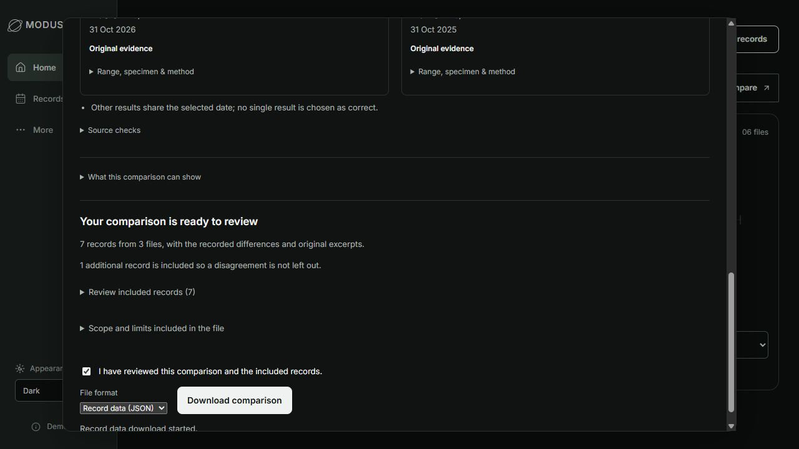

# Current service candidate — 2 November 2026

This is a runnable synthetic record-integrity prototype, not a finished
production health service or a final hackathon submission.

## Changes included

- Whole-history factual retrieval with everyday terminology, scoped previous
  result follow-ups, bounded paging, explicit correction recovery and SQLite
  contention handling.
- A personal source-file orbit, original-evidence inspectors and simpler
  review screens. Home retains at most four readings; deeper comparison stays
  inside the selected report flow.
- Printed lab ranges, specimen and method, explicit comparability rules and
  source/revision/scope-bound claim checks. An incompatible or unknown context
  does not silently become a numerical difference.
- Separate evidence for a date printed in a report header. Both its page and
  the result's page survive saving and corrections. A text match never proves
  that a date belongs to a particular result.
- **Compare reports → Prepare a summary to keep → review → download.** The HTML
  and JSON brief includes both reports' visible records, supported recorded
  differences, limitations, related discrepancies and original source excerpts.
  A stale capture, correction or changed preview blocks the download.
- A portable checked offline preview command. Source and build hashes must
  match the passing service check; protected evaluation artifacts are excluded.
  Eight frontend allowlist destinations were corrected so a fresh extract uses
  the same active frontend tree as the working app.

## Verification and its limits

The current offline service check passes **1,062 backend tests, 171 frontend
tests and the TypeScript/Vite build** on the development Windows machine.
The dedicated public checkout separately passes **1,060 backend tests, two
expected skips for excluded research wrappers, 171 frontend tests and the build**.
One existing Starlette test-client deprecation warning remains. Checks include
120-record exports, conflict companions, original preservation, old/corrected
history, stale review rejection, malformed request rejection, HTML escaping,
bounded rendering and 12 concurrent export requests. These tests do not measure
real-world extraction or clinical accuracy. CI independently runs the same
command on Windows and Ubuntu; consult the current commit's actual check status.

Two earlier authored live-service sessions on the same date made 10 actual
`muse-spark-1.3` requests: 26,404 input / 4,740 output tokens, estimated
$0.05315000 combined. All ten requests succeeded; this is the total for those
two sessions, not the project's lifetime usage. The larger session exercised
PDF/image import, review/save, blood-pressure clarification and dated lookup,
and factual conflict investigation. The two-call follow-up exercised separate
date/result pages. Narrow service checks passed 22/22 and 13/13 respectively.
The inputs and expectations were authored and reviewed by the assistant, not
independent human gold. The provider alias is mutable; invoice costs may differ.
No new API call is needed for the deterministic comparison export.

The browser flow was exercised with three newly authored CSV files: two checkups
and a conflicting copy. All seven fields were reviewed and saved through the
interface. The exported HTML and JSON retain seven records from three files,
including both conflicting TSH values. Differences are reported for CRP and
Ferritin; TSH has no invented winning value or numerical difference. The original
download matches the uploaded bytes. Review gating, download focus and a 390px
layout were checked; the browser reported no warnings or errors. These are fresh
development checks, not a new held-out score.



The separate local research workspace completed a licensed Llama 3.2 3B
100-step extraction-adapter pilot. Four new authored development probes exposed
empty-report and damaged-OCR failures; exact responses were 2/4 under the
training instruction and 1/4 under a post-hoc schema control. The base was also
format-noncompliant. This is neither an optimized baseline nor a general quality
claim. The adapter, gated weights, training inputs and local credentials are not
shipped in this repository; the adapter is disabled in the product.

## Run locally

```sh
python scripts/setup_entry.py
python scripts/check_service.py
python scripts/serve_service.py --port 8011
```

The offline preview binds only to loopback and stores records in ignored
`release/offline-service/records.db`. Closing/restarting it does not delete that
database. Explicit reviewed import remains necessary to save new records.

## Still unfinished

Independent human annotation/quality review, robust local-adapter abstention,
SAM region grounding, hosted Guard, production accounts/encryption/privacy,
native desktop packaging, organizer eligibility confirmation and the final
video/submission remain separate work. The first-party LICENSE still requires
the owner's choice. Existing historical evaluation results are not rerun or
changed to qualify this new candidate.
